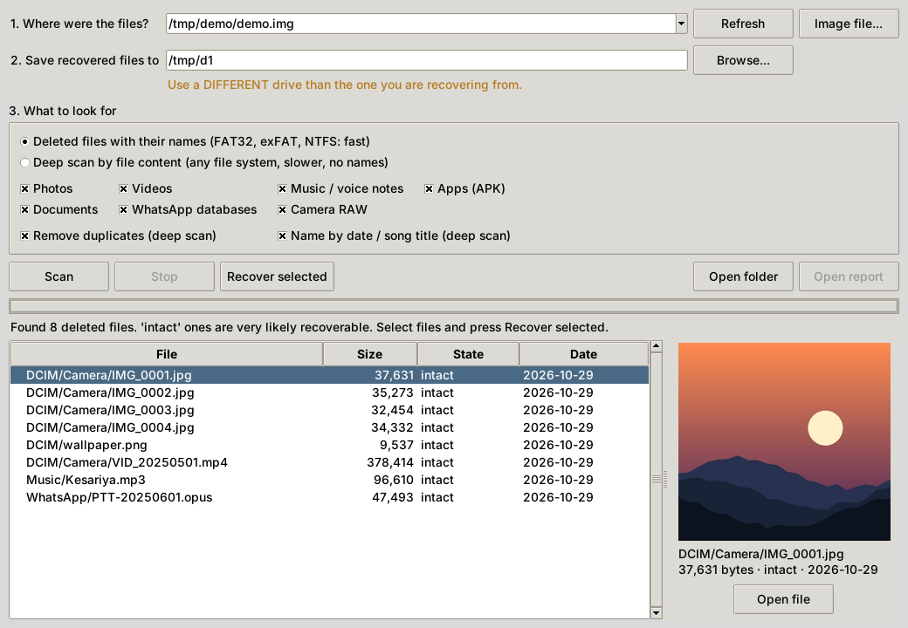
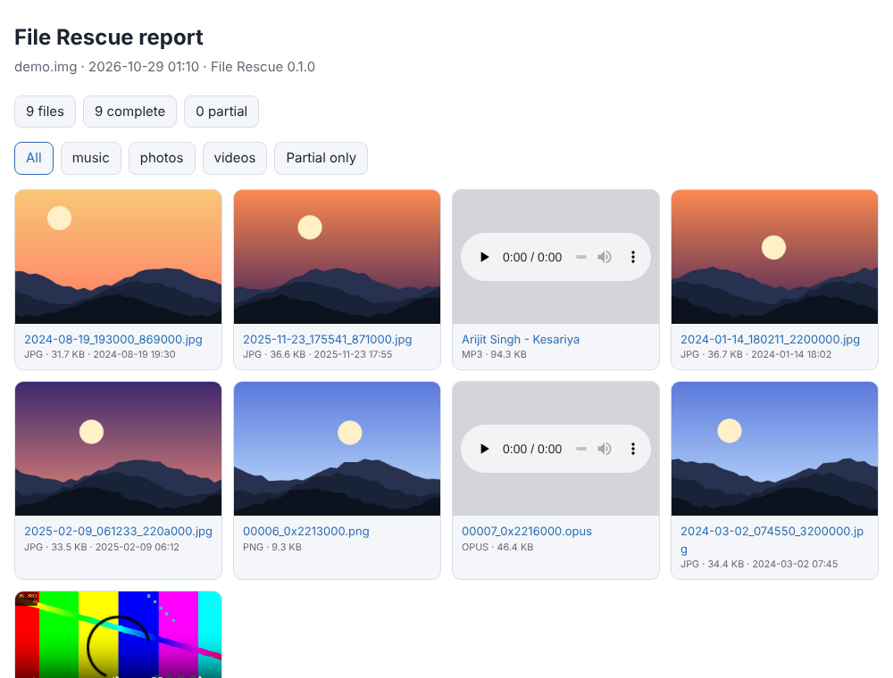

# File Rescue

[](https://github.com/Bhushansavande/file-rescue/actions/workflows/ci.yml)
[](https://github.com/Bhushansavande/file-rescue/releases)
[](LICENSE)


**Free, open-source tool to recover deleted photos, videos, music, WhatsApp media and APKs** from Windows PCs, SD cards, USB drives and Android phones. No ads, no "scan for free, pay to save", no account.



> **Most important rule:** once a file is deleted, do **not** save anything new to the drive you want to recover from. Every new write can permanently overwrite the old data. Read [docs/EDUCATION.md](docs/EDUCATION.md) first.

## Download

* **Windows, no Python needed:** from the [Releases](https://github.com/Bhushansavande/file-rescue/releases) page, download `filerescue-gui-windows-x64.exe` (double-click, asks for Administrator rights so it can read drives) or `filerescue-windows-x64.exe` (command line). Not code-signed, so SmartScreen may warn; check the download against `SHA256SUMS.txt`, or install from source.
* **Any system with Python 3.9+:** `pip install git+https://github.com/Bhushansavande/file-rescue.git` then run `filerescue gui` (Linux needs `sudo apt install python3-tk` for the window).
* **Android:** [docs/ANDROID.md](docs/ANDROID.md): over USB, directly on the phone with Termux, or the Flutter app in [android_app/](android_app/).

## What it does

| You want to... | Use | Works on |
|---|---|---|
| Get back deleted files **with their original names and folders** | `filerescue undelete` | FAT32, exFAT, NTFS: SD cards, USB sticks, Windows disks |
| Find files by content when the file system is gone, formatted or damaged | `filerescue carve` | Any drive, card or disk image |
| Restore from the Windows Recycle Bin | `filerescue recyclebin` | Windows |
| Save phone **trash, WhatsApp statuses and thumbnails** | `filerescue android` | Android (USB with adb, or on the phone with Termux) |
| Make a safe copy of a failing card first | `filerescue image` | Any drive |
| Do it all from a window | `filerescue gui` | Windows, Linux, macOS |

**File types:** JPG, PNG, GIF, WEBP, **HEIC**, AVIF, BMP, TIFF, **RAW (CR2, NEF, ARW, DNG)**, MP4, MOV, 3GP, **MKV**, WebM, AVI, MP3, M4A, WAV, **Opus (WhatsApp voice notes)**, Ogg, PDF, DOCX, XLSX, PPTX, ZIP, 7z, **APK**, **SQLite (WhatsApp databases)**.

Everything is **read-only**: the drive you scan is never written to. The command line has **no third-party dependencies** (Python 3.9+). Pillow is optional and only adds more preview types to the window.

## See what you got

Recoveries come with a browsable report (`report.html`: thumbnails, audio and video players, partial files flagged) and a `recovered.csv`. Add `--dedupe` to delete identical copies, `--date-names` to name photos by the date inside them (`2024-01-14_180211_...jpg`) and songs by `Artist - Title`, and `--by-month` to sort into `2024-01/` folders.



## Why File Rescue?

Excellent tools already exist. **PhotoRec/TestDisk** is the gold standard for carving and supports far more formats; use it for critical data. File Rescue is built for something different:

- **Names and folders back, in a window:** `undelete` reads FAT32, exFAT and NTFS directly, so recovered files keep their names, and it tells you honestly which ones are `intact` and which were `overwritten`.
- **Phone-aware:** WhatsApp statuses, voice notes, databases, trash and thumbnails: the things people actually lose on phones.
- **Small and readable:** pure Python you can read, learn from and extend. [docs/HOW_IT_WORKS.md](docs/HOW_IT_WORKS.md) explains every step.
- **Honest about limits:** partial files are flagged; the docs explain TRIM, encryption and fragmentation instead of promising miracles.
- **Tested on the real thing:** CI creates NTFS, exFAT, FAT32 and ext4 volumes with the real drivers, copies real photos, videos and music, deletes them, and checks that every file comes back byte for byte.

## Quick examples

```bash
# Deleted files with names (SD card, USB stick, Windows disk). List first, then recover.
filerescue undelete \\.\E:                       # Windows, run as Administrator
sudo filerescue undelete /dev/sdb1 -o ~/recovered   # Linux

# Deep scan by content, with report, no duplicates, date names
filerescue carve disk.img -o recovered --types photos,music --dedupe --date-names

# Safe workflow for a failing card: image first, recover second
filerescue image \\.\E: D:\sdcard.img
filerescue undelete D:\sdcard.img -o D:\recovered
filerescue carve    D:\sdcard.img -o D:\recovered_deep

filerescue recyclebin -o D:\restored             # Windows Recycle Bin, original names
filerescue android -o D:\phone                   # trash + WhatsApp statuses + thumbnails over USB
filerescue android --local -o ~/storage/shared/Recovered   # run on the phone (Termux)
```

Always write the output to a **different drive** than the one you are recovering from. `--types` takes `jpg,png`, `photos`, `videos`, `music`, `apps`, `documents`, `raw`, `databases`; `filerescue types` lists all formats.

Example output:

```text
$ filerescue undelete sdcard.img
Volume: exFAT
  2025-06-01 18:02        96,610  deleted  intact      Music/Kesariya.mp3
  2025-05-01 12:00       378,414  deleted  intact      DCIM/Camera/VID_20250501.mp4
  2024-01-14 18:02        37,631  deleted  overwritten DCIM/Camera/IMG_0001.jpg

$ filerescue carve sdcard.img -o recovered --types photos,music
  [jpg]       31,729 bytes  photos/2024-08-19_193000_869000.jpg
  [mp3]       96,610 bytes  music/Arijit Singh - Kesariya.mp3
Done: 9 complete, 0 partial -> recovered
```

## Limitations (honest ones)

- **SSDs and modern phones** use TRIM, which really erases deleted data quickly; neither method can help there. A phone's internal storage is encrypted, so only the trash, status and thumbnail folders are reachable without root.
- **Carving** cannot restore names or folders (the file system lost them); **undelete** can, as long as the directory entry survives. On FAT, a file whose name fits the old 8.3 form loses its first letter when deleted (`_iny.txt`).
- **Fragmented files** may come back incomplete. Carving reads from the start to where the file's own structure ends; `undelete` on FAT/exFAT assumes the file was stored in one piece. "Complete" means the structure was read to a clean end, not that every byte is guaranteed; open important recoveries to check them.
- **NTFS** files that are compressed, encrypted, or spread over attribute lists are listed but not recovered.
- Files with no recognizable end are saved as `_partial` (capped at 64 MB). RAW support is experimental: files end at the last byte their metadata refers to.
- MP3 detection covers songs that start with an `ID3` tag. Encrypted WhatsApp backups (`.crypt14`) cannot be opened without your key.
- Tested heavily on disk images and on virtual NTFS/exFAT/FAT32/ext4 volumes, **not yet on many physical cards and phones**. Reports from real hardware are very welcome.

## Development

```bash
python -m unittest discover -s tests -v   # unit tests, no extra tools needed
python scripts/realworld_test.py           # real media on FAT32/ext4 (needs ffmpeg, mtools, e2fsprogs, pillow)
python scripts/realworld_fs_test.py        # undelete on FAT32/exFAT/NTFS (needs root, ntfs-3g, exfat-fuse)
```

See [docs/ROADMAP.md](docs/ROADMAP.md) for what is planned and [CONTRIBUTING.md](CONTRIBUTING.md) to help; adding a new file type takes about 30 lines plus a test.

## Support

If File Rescue got something back for you, a ⭐ helps other people find it. A bug report with the exact command and output is worth just as much.

## Legal

MIT licensed. Use this only on devices you own or have explicit permission to examine; recovering someone else's data without consent may be illegal. Recovered files can contain private information, so keep them safe and never commit them to a repository.

---
Made by **Bhushan Savande** · Life Style Knowledge Hub (LSKH)
